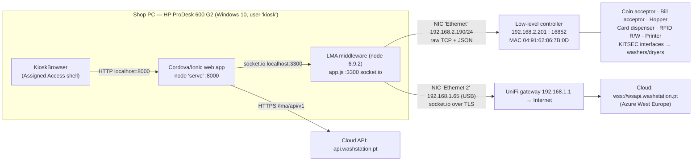

# Shop hardware & communications — as found in the live shop

> **Survey date:** 2026-09-21 · **Method:** strictly read-only inspection of the live shop PC over SSH.
> Nothing was installed, changed, restarted or written on the shop PC, and **no connection was opened to the hardware controller**.
> Secrets found along the way (cloud tokens, encrypted local state, the kiosk `vm-token`) were deliberately not read or are omitted here.

**Evidence labels used below**

| Label | Meaning |
|---|---|
| **OBSERVED** | Seen directly on the shop PC (process list, network state, files, device list). |
| **LEGACY CODE** | Read from the legacy LMA software's source/bundle running on the shop PC. |
| **INFERRED** | Reasoned from the above; not confirmed by the hardware itself. |
| **UNVERIFIED** | Could not be checked without touching the live hardware. Needs the go-live trace (see §11). |

---

## 1. Key findings (read this first)

1. **The peripherals are not connected to the shop PC.** The PC has *no* usable serial ports (its only COM port is Intel AMT Serial-over-LAN), no USB-serial adapters, and no physical printer. Coin acceptor, bill acceptor, hopper, card dispenser, RFID writer, receipt printer and the machine interfaces all sit behind a **separate "low-level" controller on the network** at `192.168.2.201:16852`. *(OBSERVED + LEGACY CODE)*
2. **The PC talks to that controller over one raw TCP connection carrying JSON** (`{"cl":"…","c":{"op":"…"}}` out, bare JSON back). The whole vocabulary (27 ops) is documented in §6. *(LEGACY CODE)*
3. **WashBubbles did not speak that protocol.** It drove peripherals directly over local serial ports (ccTalk/KITSEC/PC-SC). Its TCP transport was a stub, and its message handlers used the wrong shapes (`status_int` read from `data` instead of `dev`, `machine-issue` expected `{id,issue}`, `activateMachine` called a method that could never work). All fixed — see §9.
4. **The database already mirrors the LMA model** (peripherals with bus addresses 2/3/22/40, six 2-port KITSEC interfaces, nine machines) — but the app treated those addresses as COM-port paths, so every peripheral showed `fault`. With the gateway enabled they attach correctly. *(§8)*
5. **There is no `standby` message in the protocol.** The nearest thing is a `has-card` **keep-alive ping** the legacy bridge sends every 90 s when idle. Whether the machines/controller *require* it, or have a standby state at all, is **UNVERIFIED** (§7).
6. **The shop PC is old and exposed:** Node.js **v6.9.2** (2016), OpenSSH reachable from the internet, TeamViewer + AnyDesk + Intel AMT all running (§10). The new PC should not copy that.

---

## 1a. Second-pass corrections (2026-09-21, later the same day)

A second, deeper read of the kiosk code found three things the first pass got **wrong or missed**. All three are fixed in code and covered by tests; the earlier version of this document was wrong on the first.

| # | What was wrong | Consequence if shipped | Fix |
|---|---|---|---|
| 1 | **Coin/bill codes.** I called our hex-keyed tables (`0x01…0x06`, `0x10…0x12`) "plausible". The legacy kiosk hard-codes **decimal** tables that are never overridden: coins `"3"→€0.05, "4"→0.10, "5"→0.20, "6"→0.50, "7"→1, "8"→2`; bills sent as their euro value `"5","10","20","50"`. | With our old table a €0.05 coin (code `"3"`) credited **€0.20**, €0.10 → €0.50, €0.20 → €1.00, €0.50 → €2.00 (over-credit, shop loses money); €1 and €2 coins and **every bill were rejected**. | Controller codes are matched **exactly** (never guessed as hex). Seed/installer use the shop tables when the controller is configured; Admin › Peripherals has a **"Padrões da loja"** button; the calibration wizard stores the raw code. |
| 2 | **Machine busy/free.** I decoded the `status_int` bit as "1 = running" for every machine. The kiosk's availability logic depends on the machine's **activation polarity**: `high` → bit 1 = busy; `low` → bit 0 = busy. (Only its admin status page ignores polarity.) | 3 of our 4 dryers are `low`: they would show **busy while idle and free while running**. | Decoder reports the raw level; `coinMachine` applies the machine's polarity. |
| 3 | **New-card sequence.** I sent `write-card` immediately. The kiosk sends `card-release` → customer presents the card → controller emits `card-inserted` → **only then** `write-card` (40 s limit). | `write-card` before a card is at the reader fails; customer pays, card not written. | `write-card` now waits (40 s) for a `card-inserted` unless one is already present. |

Also found, not fixed (see §9): the receipt for controller versions **> V1.1.27** is a **Portuguese certified invoice** ("Fatura Simplificada", 23 % VAT, AT hash footer) built from the cloud billing system — out of scope here; cards carry an `ownerId` so a kiosk ignores cards of another owner; the kiosk frees an un-started reservation after **3 min** (WashBubbles has its own reservation logic).

---

## 2. The shop PC

| Item | Value | Evidence |
|---|---|---|
| Model | HP ProDesk 600 G2 Desktop Mini (board id 8169), 8 GB RAM | OBSERVED |
| OS | Windows 10 Pro 19045 (Portuguese locale, `GMT Standard Time`) | OBSERVED |
| Hostname / domain | `DESKTOP-1GJ33AA` / `WORKGROUP` | OBSERVED |
| Accounts | `Admin` (administrator, used for remote work), `kiosk` (runs the app) | OBSERVED |
| Mode | Windows **Assigned Access** kiosk: `KioskBrowser` (Microsoft Kiosk Browser) as the shell for user `kiosk` | OBSERVED |
| Boot / start | Last boot 2026-09-21 06:40; the app is started by `startup.bat` at logon of `kiosk` | OBSERVED |
| Power | "Balanced" plan, **AC standby timeout = never** | OBSERVED |
| Serial ports | **One:** `COM3` = *Intel AMT – Serial-over-LAN* (virtual, unrelated to the shop hardware) | OBSERVED |
| USB | Only a touchscreen (`VID 04F3 / PID 0732`, Elan) and a TP-Link USB Ethernet adapter | OBSERVED |
| Printers | Only virtual (PDF, XPS, Fax, AnyDesk). **No physical receipt printer attached.** | OBSERVED |

**Consequence:** any design that assumes `COM1…COM7` on the kiosk PC (as `ARCHITECTURE.md` and `pos-client/config.example.json` do) does **not** describe this shop.

---

## 3. Network and communication map



| Link | Detail | Evidence |
|---|---|---|
| **Hardware LAN** | PC NIC "Ethernet" (Intel I219-LM, 100 Mbps) = `192.168.2.190/24`, **static** (DHCP off), gateway field = `192.168.2.201`. Controller MAC `04:91:62:86:7B:0D` (vendor prefix not verified). | OBSERVED |
| **Controller session** | `node.exe` (middleware) holds an *ESTABLISHED* TCP connection `192.168.2.190 → 192.168.2.201:16852`. | OBSERVED |
| **Internet LAN** | PC NIC "Ethernet 2" (TP-Link USB), `192.168.1.65`, DHCP, gateway/DNS = UniFi `192.168.1.1`. | OBSERVED |
| **Cloud socket** | `node.exe` → `20.105.224.19:443` = `wsapi.washstation.pt` (CNAME → Azure App Service, West Europe). | OBSERVED + DNS |
| **Local UI** | `KioskBrowser` ↔ `localhost:3300` (socket.io); UI served on `localhost:8000`. | OBSERVED |
| **Cloud API** | The UI's REST base URL is `https://api.washstation.pt/lma/api/v1` (`api.washstation.pt` → `20.160.186.135`). No live connection to it was caught in the snapshot. | LEGACY CODE + DNS |
| **Ports listening on the PC** | 22 (OpenSSH), 135/139/445 (Windows), 623/16992 (Intel AMT/LMS), 3300 (middleware), 5939 (TeamViewer, loopback), 7070 + 57537 (AnyDesk), 8000 (web UI). | OBSERVED |

The controller is also the *default gateway* configured on the hardware NIC, with DNS 8.8.8.8 — **INFERRED** to be a leftover; internet traffic actually leaves through the other NIC (lower metric).

---

## 4. Software running on the shop PC (the "LMA" stack)

Everything lives in `C:\washStationProject\` and is started by `startup.bat` → `start-server.bat` + `start-middleware.bat` *(LEGACY CODE)*:

| Component | Path / process | Role |
|---|---|---|
| Kiosk web app | `lma-vm-app-0117\platforms\browser\www` served by `node …\cordova\serve` on **:8000** | Ionic/Angular UI: machine selection, payment, card top-up, admin. Built 2021, bundle ~11 MB. |
| Middleware | `lma-middleware-pt-0317\app.js` (node **v6.9.2**) on **:3300** | Bridge: socket.io (UI) ⇄ raw TCP (controller) ⇄ socket.io (cloud). Also handles shutdown/reboot/update commands. |
| State files | `local-storage.txt`, `offline-serv.txt` (both **AES-encrypted**), `vm-token.txt` (cloud auth token) | Persisted UI state, unsent offline orders, VM identity. Not read. |
| Helpers | `update-webapp.bat`, `ftp-config*.txt`, `alt+enter.ahk` (2018) | Old update/FTP tooling. |
| Backups | `lma-vm-app-0117.back/.backup/.old` | Previous builds. |

Middleware ⇄ UI socket.io events: `pkg` (UI → controller), `middleware-pkg` (controller → UI), `SET/SAVE/DELETE_VM_TOKEN`, `set/get-localstorage`, `set/get-offline-serv`, `remote-credits-res`, `shutdown`, `reboot`, `update`.
Middleware ⇄ cloud (socket.io, room `cloud.<laundryId>`): `authenticate`, `subscribe`, `send` (cloud → controller, incl. `remote-credits`), `send1` (controller → cloud), `reboot`.

---

## 5. What sits behind the controller

The PC cannot see these devices directly; it only knows them by the configuration it pushes to the controller (`config_per`, `config_int`). *(LEGACY CODE)*

| Peripheral | Type key | Bus protocol options | Notes |
|---|---|---|---|
| Coin acceptor | `coin-acceptor` | ccTalk / MDB @ 9600 | credit events `coin-inserted` |
| Bill acceptor | `bill-acceptor` | ccTalk / MDB @ 9600 | credit events `bill-inserted` |
| Hopper (coin payout) | `hopper` | ccTalk / MDB | `get-change`, `hopper-status` |
| Card dispenser | `card-dispenser` | pulse / rs232 / ccTalk | `card-release`, `has-card` |
| RFID reader/writer | `rfid-rw` | SPI (default) | `card-inserted`, `write-card` |
| Receipt printer | `printer` | rs232 | `print-receipt` (structured, controller formats it) |
| Machine interfaces | (KITSEC) | — | 2 channels each; `activate-machine`, `status_int` |

In `config_per`, `addr` is a **bus address on the controller** (not a PC COM port).
Hardware version reported by the controller via `get-version`; the kiosk changes its receipt format for versions **> `V1.1.27`** (adds billing info).

---

## 6. Wire protocol (controller ⇄ PC)

### 6.1 Framing *(LEGACY CODE)*

**PC → controller** — one JSON object per request:

```
{"cl":"<n>","c":{ "op":"…", … }}        n = len(JSON(c)) + digits(len(JSON(c))) + 14
```

The length formula is copied verbatim from the legacy bridge, including its quirk (it adds the digit-count of the *payload*, not the frame, so `cl` is one short at boundaries such as 99→100). The controller has always been sent this exact value, so WashBubbles reproduces it rather than "fixing" it.

**Controller → PC** — bare JSON objects, **no envelope**. Replies carry `code` (`"200"` ok, `"201"` card written, anything else = failure); unsolicited events do not. Everything on the wire is a **string** (ids, channels, cents, codes).

**TCP behaviour:** the legacy bridge treats each TCP `data` chunk as one message (`JSON.parse(chunk)`), silently dropping split or merged messages. WashBubbles parses a brace-balanced stream instead.

### 6.2 Operations

Direction: **→** PC to controller, **←** controller to PC. `data` amounts are **integer cents as strings**.

| Op | Dir | Payload | Reply / meaning |
|---|---|---|---|
| `status_int` | → | — | ← `{op:"status_int", dev:[{id, active:"1"/"0", status:"<bits>"}]}`. Channel *n* is `status[len−n]` and is a line **level**: with machine `activation:"high"` level 1 = busy, with `"low"` level 0 = busy. `active≠"1"` = interface offline. |
| `status_per` | → | — | ← `dev:[{type:"coin-acceptor"…, active:"1"/"0"}]` |
| `activate-machine` | → | `data:[{id, chn, impulses}]` | Starts machines from a paid order. No explicit ack seen in the kiosk; it relies on `status_int`. |
| `activate_int` | → | `dev:[{id, chn, impulses:"1"}]` | Admin test-activation of an interface. ← `activate_int` `code:"200"` on success. |
| `config_int` | → | `int:[{id, ton, toff, active}]` | Writes interface timing/config **to the controller**. |
| `config_per` | → | `per:[{protocol, baudRate, addr, type}]` (or `{type, delete:true}`) | Writes peripheral config **to the controller**. |
| `coin-inserted` | ← | `data:"<code>"` | Exact-string lookup in the coin table. Shop codes: `3…8` = €0.05…€2. |
| `bill-inserted` | ← | `data:"<code>"` | Exact-string lookup; the code is the euro value (`5,10,20,50`). |
| `get-change` | → | `data:"<cents>"` | Pay out change. ← `no-change` `data:"<cents not paid>"` (`"0"` = all paid). Kiosk falls back after 60 s. |
| `no-change` | ← | `data:"<cents>"` | Shortfall from `get-change` (also used by the "empty hopper" collection). |
| `hopper-status` | ← | `code` | `code≠"200"` ⇒ hopper not OK. |
| `has-card` | → | — | ← `code:"200"` = dispenser has cards. Also the **keep-alive** (§7). |
| `card-release` | → | — | Drop one blank card. |
| `card-inserted` | ← | `data:{cardId,name,nif,balance,new,admin,ownerId}` | Card presented. `balance` in cents. |
| `card-removed` | ← | — | Card taken. |
| `write-card` | → | `data:{cardId,name,nif,balance,new:false,admin}` | ← `code` `"200"` in progress, `"201"` written, other = failure. |
| `recharge-card` | → | `data:"<cents>"` | Legacy top-up request. |
| `print-receipt` | → | `data:{company{ownerName,name,addr,nif,phone,email}, orders[{serv,price}], total, client{name,nif,cltaddr}, credit, date, counter}` | Controller formats and prints. Every string field must be non-empty (kiosk sends `" "`). |
| `remote-credits` | ← | `data:"<cents>"` | Credit pushed from the cloud. UI answers `remote-credits-res`. |
| `machine-started`, `door-opened` | ← | `data:{id,chn}` | Events; the kiosk reacts by re-sending `status_int`. |
| `machine-reserved`, `machine-res-canceled`, `cancel-orders` | UI-internal | — | Reservation bookkeeping inside the kiosk UI; not sent to the controller. |
| `machine-issue` | ← | `data:{id, chn, active, status}` | `active:"0"` ⇒ interface offline ⇒ machine in fault. |
| `admin-mode` | ← | `enabled:"true"` | Admin card presented. |
| `get-version` | → | — | ← `data:"V1.1.xx"` (hardware version). |

---

## 7. "Standby", keep-alive and power *(the part that is not fully known)*

**What the legacy code does** *(LEGACY CODE)*: the bridge sends `{op:"has-card"}` every **90 s**, but only if the kiosk UI has sent nothing for **2 min**. The source labels this the *"activation message"* and marks it as optional. There is **no** `standby`, `sleep`, `wake` or `idle` op anywhere in the middleware or the 11 MB UI bundle (searched).

**What that suggests** *(INFERRED, not confirmed)*: the controller (or an attached device, e.g. the card dispenser or bill acceptor) may drop into an idle/standby state without traffic and this ping keeps it "active". It is also cheap and side-effect free (it only asks whether the dispenser has cards), which fits a keep-alive.

**What WashBubbles does now:** identical cadence (90 s check / 2 min idle), the ping never counts as app activity, and `machine-started` / `door-opened` events trigger a `status_int` re-read exactly as the kiosk does.

**Host power:** the shop PC is set to *never sleep on AC*. The installer applies the same.

> **Open question for the hardware vendor / go-live trace:** does the controller have a real standby state, and is the keep-alive required? Do not assume. See §11.

---

## 8. Is our database right? (comparison with the legacy model)

Checked against the local development database `washstore` (read-only queries).

| Area | Our DB | Legacy / shop | Verdict |
|---|---|---|---|
| Peripheral **types** | bill_acceptor, card_dispenser, coin_acceptor, hopper, printer, rfid_reader | same six | ✅ match |
| Peripheral **addresses** | `40`, `22`, `2`, `3`, (printer/RFID empty) with protocols `cctalk`/`pulse`/`rs232` | `config_per.addr` = controller-bus address, protocols `ccTalk`/`pulse`/`rs232`/`spi` | ✅ same model — but the app read them as COM paths, so all six showed **`fault`**. Fixed by the gateway. |
| Interfaces | 6 × KITSEC, addresses 11–16, 2 ports each | `config_int.id` + 2 channels per interface (`status_int` bit-string, 2 chars) | ✅ shape matches. ⚠️ Which ids the real shop uses is **UNVERIFIED** (cloud config not reachable). |
| Interface timing | `tOn: 5`, `tOff: 1` (model comment says **ms**) | `config_int.ton/toff` (unit not stated in the bundle) | ⚠️ **UNVERIFIED — check the unit.** If the controller expects tens of ms, 5 ms pulses may be too short to start a machine. Do **not** push `config_int` until confirmed. |
| Machines | 9 (5 wash `high`; dryers: 3 `low`, 1 `high`), `interfaceId`+`port`, `impulses:"1"` | kiosk addresses a machine by `intId` (= interface id) + `channel`; `config.activation` high/low **decides which bit level means busy** | ✅ compatible; activation sends `{id: interface.address, chn: port, impulses}`; status now honours polarity (§1a #2). |
| Machine `intId` | not set on the 9 machines | primary key in the legacy UI | ℹ️ not needed now (lookup is by interface+port). |
| Coin table | `0x01…0x06` → €0.05, 0.10, 0.20, 0.50, 1, 2 | Hard-coded in the kiosk, never overridden: `"3"→0.05, "4"→0.10, "5"→0.20, "6"→0.50, "7"→1, "8"→2` (decimal strings, exact match) | ❌ **MISMATCH (was wrongly marked ✅).** Our hex table mis-credits and rejects real coins (see §1a). Fixed for new installs; **this dev DB still holds the old hex table** and is untouched. |
| Bill table | `0x10…0x12` → €5, 10, 20 | `"5","10","20","50"` → same euro value | ❌ **MISMATCH** — every bill would be rejected; €50 missing. Same fix. |
| Hopper settings | `hopperCoinValue: 1`, `hopperMaxDispenseCoins: 50` | controller pays from its own hoppers via `get-change` (cents) | ℹ️ per-hopper coin logic is unused in gateway mode; the controller decides denominations. |
| Cash drawer / day close | present (`cashDrawerLedger`, `daycloses`) | not part of the legacy hardware protocol | ℹ️ WashBubbles-only feature. |
| Gateway location | none in DB | `192.168.2.201:16852` | ➕ now env/settings: `LOWLEVEL_HOST/PORT/ENABLED` (or `lowLevelHost/Port/Enabled` settings). |

---

## 9. Do our machines and program speak the same messages? (op-by-op)

**Verification level:** every row was exercised against a **simulated controller** (unit tests + an end-to-end run of the real backend against a fake controller and a throwaway database). **None** has been confirmed against the real controller — that is a deliberate consequence of the read-only rule. See §11.

| Op | Before | Now | Notes |
|---|---|---|---|
| Transport (TCP + `{cl,c}` framing) | ❌ stub (`connectEthernet` → "not implemented"; TODO in `sendPackage`) | ✅ `services/lowLevel.js` | Reconnect every 5 s, keep-alive, stream parser. |
| `coin-inserted` / `bill-inserted` | ❌ only serial ccTalk path | ✅ | **Exact-string** match (no hex guessing) on the controller path; unmapped code ⇒ refused, never credited; a *reply* is never treated as money. Serial ccTalk path unchanged. |
| `activate-machine` | ❌ `activateMachine()` threw on every call (`this.send(pkg)` hit the serial `send`) | ✅ | Strings on the wire; fails loudly if the controller is unreachable. |
| `status_int` | ❌ read `data.machines` — real payload is `dev` | ✅ decoded per channel **with activation polarity**, bridged into the existing idle-confirmation logic | Re-polls every 10 s while a machine is busy. |
| `machine-issue` | ❌ expected `{id, issue}` | ✅ accepts `{id, chn, active, status}` | `active:"0"` ⇒ fault. The kiosk's other branch (bit vs. polarity ⇒ OK/NOK) is the same polarity rule now applied to `status_int`. |
| `status_per` | ❌ | ✅ | Drives peripheral `ok`/`fault` on the dashboard. |
| `get-change` / `no-change` | ❌ | ✅ | Success only when the controller reports `0` unpaid; timeout ⇒ *not* success (customer owed). |
| `hopper-status` | ❌ | ✅ | Marks hoppers `fault`. |
| `has-card` / `card-release` | ❌ | ✅ | `has-card` reply gates dispensing. |
| `card-inserted` / `card-removed` / `admin-mode` | ❌ | ✅ | Feeds the existing card flow (`card-read`). |
| `write-card` | ❌ | ✅ | Waits (40 s) for `card-inserted`, then resolves only on `201`; `200` = in progress; other codes reject. Kiosk also adds `ownerId` (owner's cards) — not sent by WashBubbles. |
| `print-receipt` | ❌ (serial ESC/POS only) | ✅ | Plain text is wrapped into the structured payload. |
| `get-version` | ❌ | ✅ | Stored (`hardwareVersion`). Receipt format for **> V1.1.27** (billing info) is **not** implemented. |
| `remote-credits` | ⚠️ event only | ✅ event routed | Reply `remote-credits-res` still handled by the existing coin-machine code. |
| `config_int` / `config_per` | ❌ | ⚠️ `syncInterfaceConfig()` exists, **never called automatically** | Rewrites controller config — explicit admin action only. `config_per`, `activate_int`, `recharge-card` not implemented. |
| Standby / sleep | — | — | **No such op exists** (§7). |

Cloud link (`wss://wsapi.washstation.pt`, `remote-credits`, remote reboot) is **not** ported — WashBubbles has its own cloud/sync design and this needs a product decision.

---

## 10. Security observations on the shop PC (report only — nothing was changed)

| Observation | Risk |
|---|---|
| **OpenSSH is reachable from the internet** (a public port is forwarded to port 22; this survey itself came in that way) | Remote shell on the machine that controls cash handling. |
| **TeamViewer + AnyDesk + Intel AMT (ports 623/16992)** all active | Three more remote-control paths. |
| **Node.js v6.9.2** (EOL since 2019), Express 4.13, socket.io 1.7, lodash 4.17.4 in the middleware | Known vulnerabilities; can't be patched in place. |
| Middleware accepts `shutdown`, `reboot`, `update` (runs a `.bat`) from any socket.io client on `:3300`, and `reboot` from the cloud | Anything that can reach port 3300 can power the PC off. |
| Node.js firewall rules: *Block* on Private, *Allow* on Public | Inverted from what is normally wanted. |
| Cloud token in plaintext file `vm-token.txt`; UI state files are AES-encrypted, but the key is an app-config constant (`acst`) referenced by the shipped bundle | Weak protection of stored secrets (key location itself not examined). |

The new install binds to `127.0.0.1` only, generates its own secrets, and does not install remote-access tools.

---

## 11. What is still unknown, and how to close it safely

**Not inspected (by design):** the controller itself (no connection was opened — it may accept a single client, and the old PC holds it); the encrypted state files; the cloud account/back-end; the physical wiring and the make/model of each peripheral.

**Go-live checklist on the new PC**

1. Switch the **old PC off** first (single-client risk).
2. Run `INSTALL-FIRST-RUN.bat` (or `-DryRun` first). It sets `192.168.2.190/24` on the controller-facing NIC (no gateway), enables the gateway and starts the app.
3. Start with `LOWLEVEL_TRACE=true` in `backend\.env`. Watch `logs\backend.log` for `[HW] <- controller:` lines.
4. In this order, and only with a person at the machine: check peripherals turn `ok` (from `status_per`) → insert one coin and confirm the value (use the calibration wizard to learn the real code) → one bill → `get-change` for a small amount → print a receipt → present a card → **one** machine activation.
5. Record from the trace: the actual coin/bill code format, whether `activate-machine` gets a reply, and whether idle periods change anything. Update §7/§9 accordingly.
6. Leave `config_int`/`config_per` alone unless the controller's current settings are lost.

**Still to ask the hardware vendor:** unit of `ton`/`toff`; whether a standby state exists; whether the controller supports more than one TCP client; the meaning of the second `machine-issue` branch.

---

## 12. Migration to a new modern PC — what the installer does

`INSTALL-FIRST-RUN.bat` → `scripts\install-windows.ps1` (idempotent, supports `-DryRun`, log in `logs\`). **Written but not yet run on Windows** — try `-DryRun` first.

| Step | Action |
|---|---|
| 1 | Installs **Node.js LTS** and **MongoDB Community** via `winget` if missing; MongoDB set to start automatically. |
| 2 | `npm install` (root + backend); creates `backend\.env` with **generated** JWT/admin/kiosk secrets (never overwritten). Adds `HOST=127.0.0.1`, `SERVE_FRONTEND=true`, `LOWLEVEL_*` if absent. |
| 3 | Builds the web UI (kiosk API key baked in at build time). |
| 4 | Seeds the database **once** (the seed resets passwords, so never on re-runs). |
| 5 | Asks which NIC faces the controller and sets a **static** `192.168.2.190/24` with **no gateway** (asks first). ICMP check only; TCP check only with `-CheckController`. |
| 6 | Power plan: never sleep / screen-off / hibernate on AC (same as the shop PC). |
| 7 | Scheduled task **WashBubbles Kiosk** runs `start-kiosk.bat` at logon. |

`start-kiosk.bat`: runs the installer if `.installed` is missing (first run), starts the backend with an auto-restart loop, waits for `/api/health`, then opens Edge full-screen kiosk on `http://localhost:3000`.

**Not automated (do manually):** Windows auto-logon for the kiosk user, Assigned Access lock-down, remote-access tooling, Windows Update policy.

---

## 13. Offline behaviour, and who owns the card balance

### 13.1 Does the reader write the cards, or is it "just the database"?

| | **Legacy kiosk (shop today)** | **WashBubbles (ours)** |
|---|---|---|
| Where the balance lives | **On the card.** `card-inserted` carries `{cardId, name, nif, balance(cents), admin, ownerId}`; the kiosk uses exactly that (`setClientInfoByCard(card)`). | **In our database** (`cards` collection). |
| Who writes the card | The controller, on `write-card`, after **every** balance change: card purchase, top-up, each payment (kiosk sends `write-card` with the new balance, waits for code `201`, and only then completes the order). | Written **once**, at activation (`POST /pos/card/write/:code`: a JSON snapshot of code, balance, name, e-mail, phone, tax id). **Never rewritten afterwards.** |
| What a later read uses | Balance, name, NIF from the card. | Only the card **code**; balance is looked up in the DB. The balance stored on the card goes stale after the first spend. |
| Cloud/DB role | Audit ledger: orders (`orders/neworder`) and `CHARGE_CARD` records. Not authoritative for the balance. | Authoritative wallet. |

So the reader **does** read and write cards in both systems — but in the legacy system the card is the wallet, and in ours it is mostly an ID token whose stored balance is a one-time snapshot.

### 13.2 Offline behaviour — legacy kiosk *(LEGACY CODE)*

- Detects connectivity with `navigator.onLine` plus the Cordova network plugin (`OfflineData.setNetworkConnection`).
- **Card use needs no internet:** balance/name/NIF come from the card, and the payment is written back to the card by the controller.
- Machines, prices and programs are served from a **cached copy** (`wasMachines`, `dryMachines`, `programs`) stored encrypted in `local-storage.txt` and refreshed whenever online.
- Orders and new-card purchases that cannot be posted are queued (`UnsavedOrders`) in encrypted `offline-serv.txt` on disk (survives a reboot), flagged `offline:true` with the **card number stripped**, and re-sent when the network returns — one every second. A record is **discarded after 6 failed attempts**. At survey time that file was 46 bytes, which is consistent with an empty queue *(INFERRED)*.
- Needs the internet: admin login, cloud dashboard, `remote-credits`, remote reboot, the certified-invoice data on receipts.

### 13.3 Offline behaviour — WashBubbles *(read from code, plus a test)*

- **Core flows need no internet** when installed as designed (backend + MongoDB on the kiosk PC): coins, bills, hopper, card lookup/spend, machine start, day close. The React UI has **no** offline layer of its own (no service worker or queue) — it doesn't need one while the backend is local.
- Internet-dependent, all non-critical: WhatsApp cycle-complete (fire-and-forget, safe), operator alert e-mails (no-op when unconfigured), **receipt e-mail** (`POST /pos/receipt` awaits SMTP with no timeout or error handling, so offline the request can hang), Google Fonts and one decorative image (`s3…/wave.svg`) referenced from CSS (fallback fonts, image missing). UniFi guest-WiFi vouchers use the LAN controller, not the internet.
- Unless the central uplink of §14 is configured, there is **no cloud ledger or sync** in the shop install. Balances exist **only** in the local database, so a disk failure loses every card balance unless MongoDB is backed up. **The installer does not set up backups.**

### 13.4 Consequence for the migration (decided: Option C — implemented, see §13.5)

**Test result:** a legacy card carrying €12.50 inserted into WashBubbles is reported as `card-invalid` and used with balance 0, because the card id is not in our (empty) database. The same is true for every existing customer card in the field.

Options:

| Option | How | Trade-off |
|---|---|---|
| **A. Card is the wallet** (legacy-compatible) | In controller mode read the balance from `card-inserted` and write it back with `write-card` after each transaction. | Works offline and with all existing cards; no DB backup dependency. Same trust model as today (a tampered/cloned card is trusted). Bigger change to the payment flow. |
| **B. Import into the DB** | Export card ids/balances from the LMA cloud and load them. | Keeps our DB-wallet model. Needs the cloud export, and on-card balances are then ignored (risk of drift if any legacy kiosk keeps running). |
| **C. Adopt on first sight** | Unknown card ⇒ create it in the DB from the on-card balance once, then DB is authoritative and each spend is also written back to the card. | Smooth cut-over with no export; keeps card and DB in step. Trusts the on-card balance one time; needs a rule against double adoption. |

Small fixes regardless of the option: add a timeout/error response to the receipt e-mail route, self-host the fonts/image, and schedule `mongodump` backups in the installer.

### 13.5 Option C as built: the card AND the database both hold the balance

Goal: **no client ever loses money** — if the database is lost (new PC, dead disk, old backup) the card restores it, and if a card is lost or damaged the database still has the balance. Code: `backend/src/services/cardSync.js`; active only in controller mode (`LOWLEVEL_*` set); `CARD_SYNC=false` turns it off.

**What a card carries** (from the controller's `card-inserted`): card id, balance (cents), name, tax number (NIF), an admin flag and an owner id. All of it is used:

| Field | Use |
|---|---|
| id | Identifies the customer; adopted as the card `code`. |
| balance | Adopted / reconciled / written back (below). |
| name, NIF | Imported on adoption; later only to **fill blanks** in our record (never overwrite); kept as-is on every write-back if our record has none. |
| owner id | Kept when the card is rewritten (so other kiosks' owner checks are not broken); recorded at adoption. |
| admin flag | Admin cards are keys, not wallets — never adopted or rewritten. |
| e-mail, phone, bonus points | **Not carried** by legacy cards — database only. |

**The rules**

| Event | What happens |
|---|---|
| Unknown card inserted | **Adopt:** create the record from the card (atomic — two simultaneous adopters create one). Refused above **€1000** (`CARD_SYNC_MAX_BALANCE`) or if unreadable; logged. |
| Any balance change in the database (spend, top-up, auto-charge, admin edit, sync push) | The new balance is **written to the card** if that card is at the reader; up to 3 retries. Caught by a hook on the `Card` model, so no route can forget it. |
| Card inserted, balances differ | Uses `cardSyncedBalance` (what the card was last confirmed to hold): card still at that value ⇒ the card missed an update ⇒ **database wins**, card is rewritten. Database still at that value ⇒ card was used elsewhere or the database was restored ⇒ **card wins**. Anything else ⇒ **keep the lower figure**. All non-trivial outcomes are written to the audit log (`card.adopt`, `card.reconcile`, `card.reject`). |
| Write to the wrong card | Never: the write is refused unless the card at the reader is the one named. |

**Proven** (test suite + a real end-to-end run with a controller that remembers the card): an existing €12.50 card is adopted; a €2.50 spend leaves the database at €10.00 **and** rewrites the card to €10.00; after wiping the database completely, reinserting the card restores **€10.00** — not the old €12.50, not zero.

**Limits (honest list)**

- **Cash moved onto the card at removal** (the unspent-cash rule) happens after the card is gone, so it cannot be written then. It is written the **next time the card is inserted** (database-wins). If the database were lost in that window, that unspent amount would be missing from the card.
- **Bonus points and e-mail/phone** exist only in the database.
- **Trust:** as in the legacy system, a card's balance is believed (up to the ceiling). A card tampered *upward* is accepted whenever the database is at its last-confirmed value; the event is audit-logged. Lower the ceiling if that worries you.
- **Backups are still needed** for everything that is not on a card: sales history, prices, settings, users. The installer does not yet schedule them.
- **UNVERIFIED on the real controller:** that `write-card` works on a card that is already inserted and returns `201`; whether the controller then re-announces the card (handled: a same-card echo is ignored); whether the `card-inserted` payload always includes `ownerId`/`nif`. Watch the first cards with `LOWLEVEL_TRACE=true`.

---

## 14. Offline payments (coins, bills, cards) and updating the central DB when online

**Which runtime this covers.** The repo has two kiosk designs: the Electron POS client (offline-first with local SQLite, but direct-serial only — it cannot talk to the shop's controller) and the backend + local MongoDB that this document's controller support, card sync and installer target. §14 gives the second one the offline-first guarantees the first already had.

**Payments never wait for the internet.** Coins, bills and cards are handled entirely on the shop PC (controller, local MongoDB). What used to be missing was (a) any way to send the results to a central DB later, and (b) protection for cash that was in the machine when the PC lost power.

### 14.1 Central uplink (`backend/src/services/uplink.js`)

- Every **sale** (cash from coins/bills, card payments, recharges, card purchases, refunds), every **card balance change** and every **day-close** is written to a durable local queue (`SyncOutbox`, in the same database) **in the instant it happens**.
- A worker pushes the queue to the central server's existing `/api/sync/push/*` endpoints whenever it can be reached (immediately when online, otherwise every 30 s with back-off up to 5 min). It also drains whatever was left after a restart.
- **Being offline is not an error:** nothing is dropped and nothing counts against a record. The server's endpoints are idempotent (sales/day-closes by `local_id`, card creation by code, card balance is an absolute value), so a request whose reply was lost is simply repeated.
- **Cards:** many changes while offline collapse into **one** update with the latest balance (create → activate → set balance). A change that arrives while a push is in flight is never lost.
- **Failures:** 5xx → retried indefinitely; other 4xx → after 10 tries the record is set aside as *dead* (visible, retryable); a rejected API key (401/403) keeps everything and retries every 5 min.
- **Setup:** set `SYNC_SERVER_URL` (e.g. `https://api.washbubbles.app/api`) and `SYNC_API_KEY` (the kiosk key issued by that server) in `backend\.env`. Unset = disabled and nothing is queued.
- **Operator view:** `GET /api/admin/sync/status` (enabled, online, pending, dead, last sync, last error), `POST /api/admin/sync/flush`, `POST /api/admin/sync/retry-dead`.

### 14.2 Inserted cash survives a power cut (`backend/src/services/cashSession.js`)

The coins and bills a customer has fed in are credited in memory, so a crash or power cut erased them while the money sat in the machine. Now every change is written to `data/cash-session.json` (synchronously, atomically, fsync'd) **before** the credit is shown, and restored on start-up. It is a file rather than the database on purpose: it must work when the database is what is down. A restore is audit-logged (`cash.session.recovered`). **Only cash from the last 30 minutes is restored** (`CASH_SESSION_RESTORE_MINUTES`); older cash is *not* handed to whoever walks up next but recorded (`cash.session.expired`) for the operator.

### 14.3 Proven

Tests (unit and against the real test database with a fake central server that goes offline / errors / drops mid-request) plus an end-to-end run of **two real backends**: with the central server down the site accepted a €1 coin and a €10 bill and recorded a cash sale (€1.50 sale, €11 inserted, €9.50 change); the queue survived a `kill -9`; after restart the site reported `Recovered €11.00`; when the central server came up one flush delivered the sale and the card (12.50, Ana, active); a second flush sent nothing twice.

### 14.4 Limits (honest list)

- **Needs a central server and its key.** Nothing exists to sync to until you configure one; records created *before* it is configured are not back-filled.
- **Machine and card ids are not sent** (they are this site's local ids): the central sale has amounts, method, card code and `items`, but no link to a central machine record.
- **Card balances are last-writer-wins**, which is right for a single-kiosk site whose cards carry the truth (§13.5). If several sites shared cards through the central server, use delta pushes instead.
- **Money lost while the backend is not running.** If the controller reports a coin at the instant the backend process is down, whether the controller re-sends or buffers it is **unverified** (the legacy kiosk has the same exposure). Test by inserting a coin during a backend restart.
- The **cash-drawer ledger** (per-denomination prefill for day-close) is unchanged: it is a convenience, not accounting, and a missed increment while the database is down is not replayed.
- The Electron POS client is unchanged and still cannot drive the controller; it is not part of the shop install.

---

## 15. Outbound email

**Mailbox:** `marcacoes@freshbubbles.pt`, hosted at amen.pt. `backend/src/services/mailer.js` is a thin nodemailer wrapper already used by every feature that sends mail — no new code was needed for these, only real configuration:

| Feature | Where | Trigger |
|---|---|---|
| Password reset | `POST /api/auth/forgot-password` (`routes/auth.js`) | Admin/staff "forgot password" |
| Day-close (Fecho de Caixa) report | `emailDayCloseReceipt` (`services/dayClose.js`) | Admin day-close screen, "email this report" |
| Customer receipt | `POST /api/pos/receipt` (`routes/pos.js`) | Kiosk, after a sale |
| Operator alerts (hopper empty, RFID fault, kiosk offline, ...) | `services/alerts.js`, `services/kioskWatchdog.js` | Hardware/health events, if `alerts.email` is set (Admin > Definições > Alertas) |
| Marketing broadcast | `POST /api/admin/marketing/broadcast` | Admin, to opted-in customers only |

**amen.pt's documented SMTP settings** (verified against amen.pt/assistencia/configuracao-email, 2026-09): host `smtp-pt.securemail.pro`, port `465`, SSL, username = the full email address, password = the one set when the mailbox was activated. `mailer.js` picks implicit TLS automatically for port 465 (any other port starts in plaintext and upgrades via STARTTLS if offered) — no extra flags needed.

**Setup:** in `backend\.env` (never committed):

```
MAIL_HOST=smtp-pt.securemail.pro
MAIL_PORT=465
MAIL_USER=marcacoes@freshbubbles.pt
MAIL_PASS=<the amen.pt mailbox password>
MAIL_FROM=marcacoes@freshbubbles.pt
# MAIL_FROM_NAME=Fresh Bubbles   # optional "Display Name <address>"
```

With `MAIL_HOST` unset (the default in every environment set up so far, including this dev machine), `mailer.js` logs what it would have sent instead of erroring — password reset, receipts, etc. all still respond success, they just don't deliver. The installer's generated `.env` includes the block above commented out, ready to uncomment once the mailbox password is on hand (§12).

**Proven:** unit tests (`backend/test/mailer.test.js`) confirm the exact transporter options built for amen.pt's settings (host, port 465, `secure: true`, username = full address) and for a generic STARTTLS provider (`secure: false`), the `MAIL_FROM_NAME` display-name formatting, and that a changed `MAIL_HOST` rebuilds the transporter rather than keeping a stale one. **Not proven:** an actual send through amen.pt — that needs the real mailbox password, which was not provided, and sending a real email is a user-facing action this survey did not take on its own.

---

## Appendix — where things are

| What | Where |
|---|---|
| TCP/JSON transport, framing, parser, status decoder | `backend/src/services/lowLevel.js` |
| Gateway routing and op handling | `backend/src/services/middleware.js` (`connectLowLevel`, `isGatewayPeripheral`, `handlePackage`, `*ViaGateway`) |
| Status/issue bridging into machine state | `backend/src/services/coinMachine.js` (`handleGatewayMachineStatus`, `handleMachineIssue`) |
| Tests (32) | `backend/test/lowLevel.test.js` |
| Env variables | `backend/.env.example` (`LOWLEVEL_*`, `SERVE_FRONTEND`, `HOST`) |
| Installer / launcher | `INSTALL-FIRST-RUN.bat`, `scripts/install-windows.ps1`, `start-kiosk.bat`, `scripts/run-backend.bat` |
| Outbound email (amen.pt) | `backend/src/services/mailer.js`, `backend/test/mailer.test.js`, `backend/.env.example` (`MAIL_*`) |
